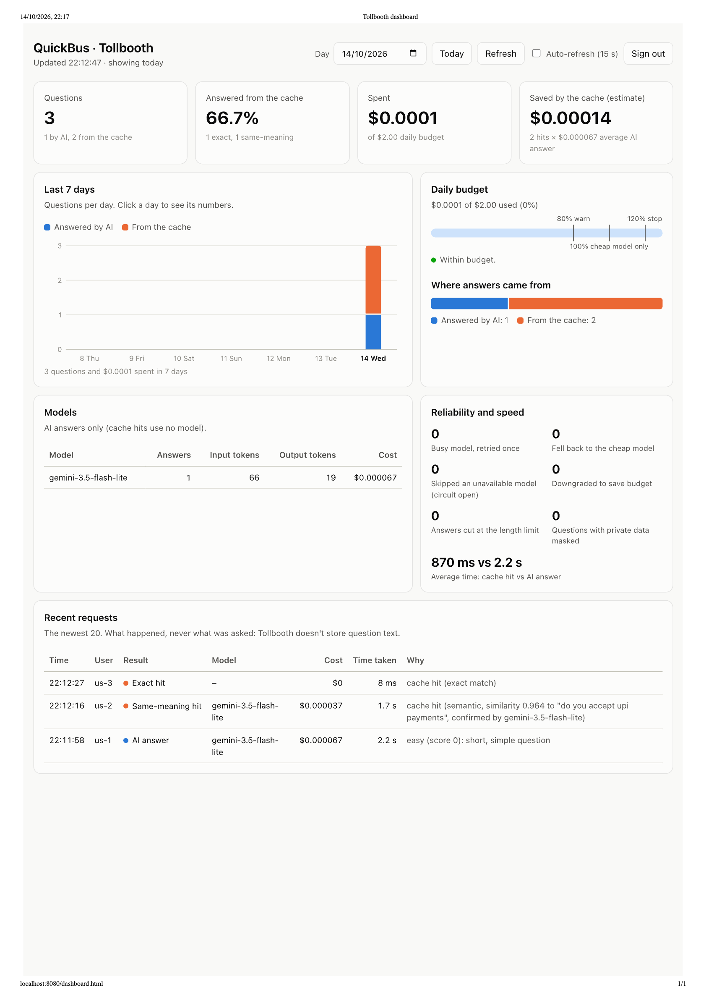
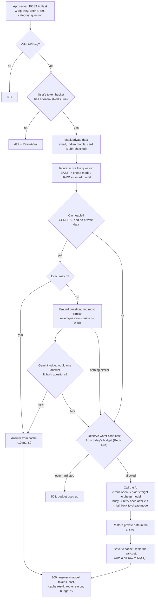
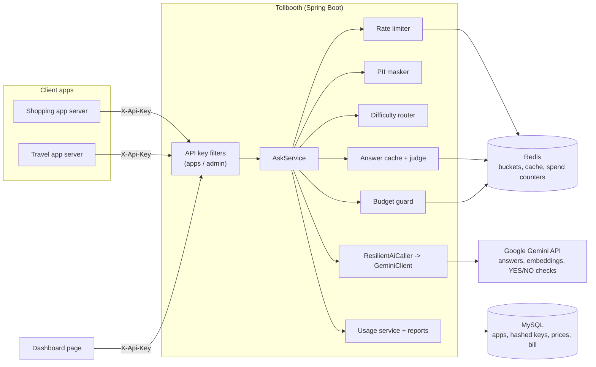
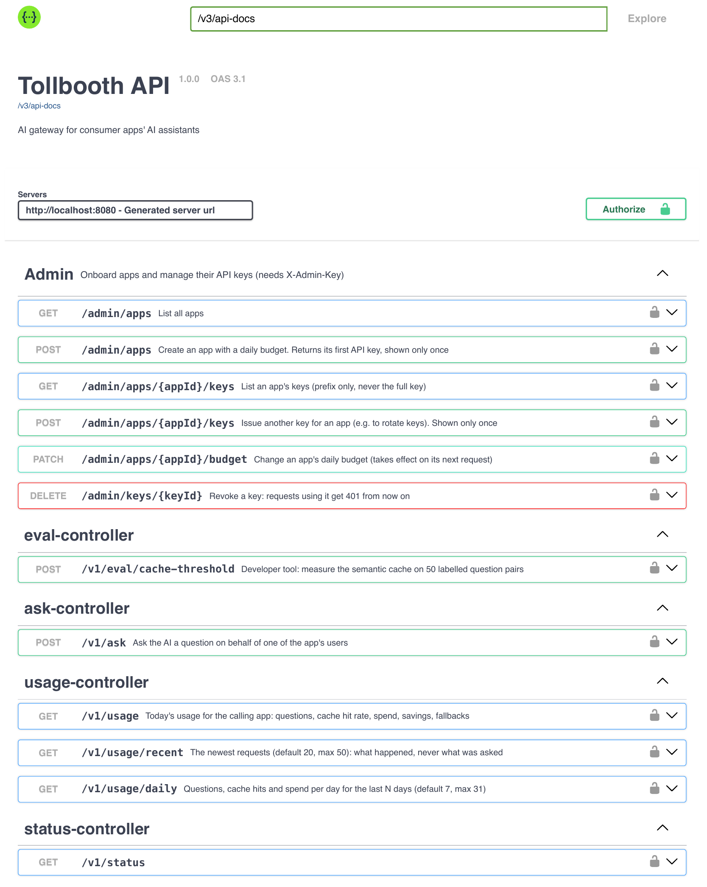
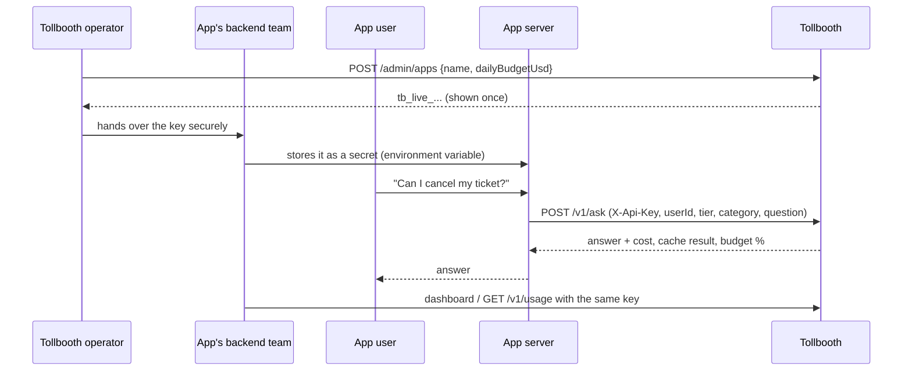

# Tollbooth

**An AI gateway for consumer apps' chat assistants.** An app like a shopping, travel or food-delivery service sends its users' questions to Tollbooth instead of straight to the AI model. Tollbooth limits each user, hides private data, routes easy and hard questions to different models, reuses answers it has already paid for, keeps each app inside a daily budget, and records every request.

Java 21 · Spring Boot 3.5 · MySQL 8.4 · Redis (with Lua scripts) · Google Gemini · Docker Compose · JUnit 5


*The usage dashboard at `/dashboard.html`: one app's day at a glance.*

---

## Why an AI gateway?

When a consumer app adds an AI assistant, the same problems show up every time:

| Problem | What goes wrong without a gateway | What Tollbooth does |
| --- | --- | --- |
| **Cost** | Thousands of users ask the same things; every question is paid for again | Answer cache (exact and same-meaning), cheap model for easy questions, hard daily budget |
| **Abuse** | One user or bot can send thousands of requests | Per-user token bucket rate limit, bigger allowance for premium users |
| **Privacy** | Phone numbers, emails and card numbers reach a third-party AI | Masked before the AI call, restored in the answer, never stored |
| **Outages** | The AI provider is busy, and the user sees an error or waits | Circuit breaker skips a model that keeps failing, one retry for a busy model, fallback to another model; the budget reservation is given back on failure |
| **Visibility** | Nobody knows what the AI costs per day or what the cache saves | A bill row for every request, a daily report and a dashboard |

---

## How a question flows



Every response explains itself. A real `routeReason` from testing:

```
hard (score 5): keyword 'plan a', money amount, limit word, number of days/people;
gemini-3.6-flash busy, retried once after 2000 ms;
gemini-3.6-flash failed (AI provider busy (HTTP 503)), fell back to gemini-3.5-flash-lite
```

## Architecture



---

## Features

| Feature | How it works | Where |
| --- | --- | --- |
| **App onboarding** | An operator creates an app with a daily budget and gets a `tb_live_...` key (256 random bits), shown once. Only its SHA-256 hash is stored. Keys can be added and revoked. | `admin/` |
| **Authentication** | `X-Api-Key` header, looked up by hash. App keys and the admin key are separate roles: neither works on the other's endpoints. | `security/` |
| **Rate limiting** | Token bucket per user per app, in a Lua script that runs atomically inside Redis. Regular 5 per burst, refill 1 every 12 s; premium 10, refill 1 every 6 s (demo values). Fails open if Redis is down. | `ratelimit/`, `token_bucket.lua` |
| **Private-data masking** | Emails, Indian mobile numbers and card numbers (Luhn-checked to avoid false positives) become `[EMAIL_1]`-style placeholders before the AI call and are restored in the answer. The mapping lives only in memory for that request. | `pii/` |
| **Difficulty routing** | Explainable scored rules, no AI: thinking words (+2), money, limits, days/people (+1 each), length, several questions. Score 2+ is HARD. | `routing/` |
| **Answer cache** | Exact level (normalized question hash) and same-meaning level (Gemini embeddings, 768 dimensions, cosine similarity), then a Gemini YES/NO judge. Only GENERAL questions with no private data; separate per app; 24 h expiry. | `cache/` |
| **Daily budget** | The worst-case cost is reserved atomically before each call (answers are capped at 2,048 tokens) and settled to the real cost after. Warning at 80%, cheap model only at 100%, stop at 120%. | `budget/`, `budget_reserve.lua` |
| **Retry and fallback** | A busy model (HTTP 500/503) is retried once after 2 s, then the cheap model answers. Quota errors and timeouts are not retried. | `ai/ResilientAiCaller` |
| **Circuit breaker** | After 3 requests in a row find a model unavailable, it is skipped for 60 s and its questions go straight to the cheap model, with no wasted calls or retry waits. Then one trial request tests it: success closes the circuit, failure opens it for another 60 s. States are shown at `GET /v1/status`. | `ai/ModelCircuitBreaker` |
| **Usage metering** | Every request writes a bill row: model, tokens, cost, cache result, route reason, latency, number of masked values. Never the question text. | `service/UsageService` |
| **Reports and dashboard** | `GET /v1/usage`, `/usage/daily`, `/usage/recent`, and a dashboard page at `/dashboard.html` that signs in with the app's own key. | `web/UsageController`, `static/dashboard.html` |
| **Evaluation tool** | `POST /v1/eval/cache-threshold` runs 50 labelled question pairs through the cache and reports accuracy, wrong hits and missed savings. | `eval/` |

---

## Measured results

These come from the project's own tests: hand-labelled question pairs and local runs on the Gemini free tier. They are not production traffic.

### The cache: similarity alone is not enough

50 hand-written pairs (`src/main/resources/eval/cache-pairs.json`): 25 that need the same answer, 25 that look alike but don't (return vs exchange, check-in vs check-out, a 3-day vs 5-day trip).

- A pair needing **different** answers scored up to **0.975** ("Plan a 3-day trip to Goa…" vs "…5-day…").
- A pair needing the **same** answer scored as low as **0.873** ("What is your return policy?" vs "Can I return shoes that don't fit?").
- At the original auto-accept line of 0.94, **7 of 25** look-alike pairs would have received a wrong answer. The lowest line with no wrong hits was 0.98, where nothing is accepted.

So similarity is only used to find the closest candidate; a judge decides. Two judges were measured on the 39 pairs scoring 0.88 or more:

| Judge | Right | Wrong hits it would allow | Cost per check |
| --- | --- | --- | --- |
| Similarity alone (auto-accept at 0.94) | — | 7 | $0 |
| Open-source duplicate-question model ([quora-distilroberta-base](https://huggingface.co/cross-encoder/quora-distilroberta-base)) | 18 of 39 (46%) | 3 | $0 (own container) |
| **Gemini YES/NO check** (`gemini-3.5-flash-lite`) | **38 of 39 (97%)** | **1** | **~$0.00004** |

With the Gemini check on all similar questions (easy and hard): **24 of 25** paraphrases reused the saved answer, and **24 of 25** look-alikes were correctly answered fresh. The **1** wrong hit was "return policy" vs "refund policy", a debatable label. The YES/NO instruction was written once and not reworded to score better on these 50 pairs, so the result is an honest estimate, not overfitted.

A check costs about 1/40 of a typical cheap answer, and about 6 in 10 checks said YES (25 of 39), so checking every similar question pays for itself.

### Concurrency

| Test | Result |
| --- | --- |
| 100 simultaneous requests against a bucket of 20 | Exactly 20 allowed |
| 50 simultaneous budget reservations wanting the smart model (room for 10) | Exactly 10 get the smart model; the rest get the cheap one until the hard stop |
| 50 simultaneous reservations against a hard stop of 1,200 micro-dollars (worst case 50 each) | Exactly 24 allowed; the counter ends at exactly 1,200 |

### Bugs found by testing, and fixed

- **Budget at 267% after one request.** The reservation assumed 400 output tokens; a planning answer used 1,459 (thinking tokens are billed as output). Fixed by capping answers at 2,048 tokens and reserving that worst case; spending can no longer pass the hard stop.
- **A slow AI reply became a raw 500**, skipping the fallback and keeping the budget reservation. Fixed with a catch-all for HTTP client errors and a release of the reservation on any failure.
- **Similarity auto-accept gave wrong answers** (above). Replaced by a measured judge.

---

## Run it locally

**You need:** Java 21, Docker Desktop, Maven (or IntelliJ IDEA, which includes it), and a free Gemini API key from [Google AI Studio](https://aistudio.google.com).

```bash
docker compose up -d                          # MySQL and Redis

export GEMINI_API_KEY=your-gemini-key         # never commit this
export TOLLBOOTH_ADMIN_KEY=pick-a-long-secret # enables the admin API; never commit this

mvn spring-boot:run                           # http://localhost:8080
```

In IntelliJ, add both variables to the run configuration's **Environment variables** instead of `export`.

On first start Tollbooth creates a demo app, **DemoShop**, with the key `tb_demo_key_change_me` and a $5 daily budget (see `tollbooth.demo` in `application.yml`).

## Try it

**1. Onboard an app** (this is how a new client gets its key):

```bash
curl -X POST http://localhost:8080/admin/apps \
  -H "X-Admin-Key: $TOLLBOOTH_ADMIN_KEY" -H "Content-Type: application/json" \
  -d '{"name":"QuickBus","dailyBudgetUsd":2.00}'
```

```json
{ "appId": 2, "appName": "QuickBus", "dailyBudgetUsd": 2.00, "keyId": 2,
  "apiKey": "tb_live_xxxxxxxxxxxxxxxxxxxxxxxxxxxxxxxxxxxxxxxxxxx",
  "note": "Save this key now: it is shown only once. Tollbooth stores only its hash." }
```

**2. Ask questions with that key:**

```bash
curl -X POST http://localhost:8080/v1/ask \
  -H "X-Api-Key: tb_live_..." -H "Content-Type: application/json" \
  -d '{"userId":"user-42","userTier":"REGULAR","category":"GENERAL","question":"Do you accept UPI payments?"}'
```

Ask `"Can I pay with UPI?"` next: the response has `"cacheResult": "HIT_SEMANTIC"`, the header `X-Cache: HIT-SEMANTIC`, and a `routeReason` saying it was confirmed by the judge. Ask it once more: `HIT_EXACT`.

**3. Open the dashboard:** http://localhost:8080/dashboard.html and sign in with the app's key.

**4. Explore everything in Swagger:** http://localhost:8080/swagger-ui.html. Click **Authorize** and enter the app key (`apiKey`) and/or the admin key (`adminKey`).


*Every endpoint, generated from the code by springdoc-openapi, with "Try it out" buttons.*

Authorize accepts any text, because Swagger only stores it in your browser; the key is checked on each request, so a wrong or revoked key gets a 401 there.

### How a real app would integrate



The key lives only on the app's **server**, never in its mobile app or website, where anyone could read it. The app decides the `category`: `GENERAL` for questions any user could ask (cached and shared), `PERSONAL` for anything about one user's own order or booking (never cached).

---

## API

| Method and path | Key | What it does |
| --- | --- | --- |
| `POST /v1/ask` | app | Ask a question for one of the app's users |
| `GET /v1/usage?date=` | app | One day's report: questions, hit rate, spend, savings, retries, fallbacks, per-model costs |
| `GET /v1/usage/daily?days=7` | app | Questions, cache hits and spend per day |
| `GET /v1/usage/recent?limit=20` | app | Newest requests: result, model, cost, latency, reason (no question text) |
| `POST /admin/apps` | admin | Create an app and its first key |
| `GET /admin/apps` | admin | List apps |
| `PATCH /admin/apps/{id}/budget` | admin | Change an app's daily budget |
| `POST /admin/apps/{id}/keys` | admin | Issue another key (rotation) |
| `GET /admin/apps/{id}/keys` | admin | List keys (prefix only) |
| `DELETE /admin/keys/{id}` | admin | Revoke a key |
| `POST /v1/eval/cache-threshold?runGeminiCheck=` | app | Developer tool: measure the cache on the 50 labelled pairs |
| `GET /v1/status` | none | Is it running, is Redis reachable, and each AI model's circuit state |
| `GET /actuator/health` | none | Health of the app, MySQL and Redis |

Errors are JSON in the standard [Problem Details](https://www.rfc-editor.org/rfc/rfc9457) format. Status codes: 400 invalid request, 401 missing or invalid key, 403 wrong kind of key, 404, 409 app name taken, 429 rate limited (with `Retry-After`), 502 or 503 AI provider problem or budget used up.

## Configuration

All settings are in `src/main/resources/application.yml`, with comments. The main ones:

| Setting | Default | Meaning |
| --- | --- | --- |
| `tollbooth.ai.cheap-model` / `smart-model` | `gemini-3.5-flash-lite` / `gemini-3.6-flash` | Models for EASY and HARD questions |
| `tollbooth.ai.max-output-tokens` | 2048 | Longest answer; also the budget's worst case |
| `tollbooth.ai.retry-delay-ms` | 2000 | Wait before retrying a busy model |
| `tollbooth.ai.circuit-breaker.*` | 3 failures, 60 s | When a model is skipped, and for how long |
| `tollbooth.rate-limit.*` | 5 / 12 s, premium 10 / 6 s | Bucket size and refill time per tier |
| `tollbooth.budget.*` | 80 / 120, Asia/Kolkata | Warning and hard-stop percentages; when "today" starts |
| `tollbooth.cache.semantic-threshold` | 0.88 | Minimum similarity for a candidate |
| `tollbooth.cache.judge` | `gemini` | `gemini` or `duplicate-model` |
| `tollbooth.cache.check-easy-questions` | true | Let the paid judge check easy questions too |
| `tollbooth.eval.enabled` | true | The evaluation endpoint; set to false in production |
| `GEMINI_API_KEY`, `TOLLBOOTH_ADMIN_KEY` | (environment) | Secrets, only ever from environment variables |

---

## Design decisions

- **Lua scripts in Redis for every check-then-update** (rate limit, budget reservation). Redis runs a script as one step, so concurrent requests can't both pass a check that only one should. Verified with simultaneous-request tests.
- **Every request is checked, nothing is remembered.** The API is stateless: there is no login session, so every request must carry its key, and the key is looked up (by hash) each time. That is what lets a revoked key stop working on the very next request. Checking a key once and then trusting the caller would let a revoked or stolen key keep working. (Swagger's **Authorize** button only stores the key in the browser and never contacts the server, so it accepts any text; the first real request is where a bad key gets its 401.) The dashboard's sign-in does check straight away: it calls the API with the key and stays on the sign-in screen if the key is wrong or revoked.
- **Money as whole micro-dollars (`long`) in Redis and `BigDecimal` in Java**, never `double`, so sums don't drift. Costs round up, so spend is never under-counted.
- **Reserve, then settle.** The real cost is only known after the AI answers, so the worst case is held first (like a card pre-authorisation) and corrected after.
- **Rules for routing, not AI.** Free, instant, unit-tested, and they explain themselves in `routeReason`. A mistake costs a little money or gives a slightly weaker answer, never an error.
- **Retrieve, then verify for the cache.** Embeddings are fast at finding candidates but can't tell "same answer" from "one detail changed". A judge decides, chosen by measurement.
- **Circuit breaker on top of retry.** A retry helps when a model is briefly busy; when it is down for minutes, retrying every request wastes seconds per user. Only "unavailable" failures (busy, rate limited, timed out) count, because a bad answer to one question says nothing about the model's health. If there is no other model to fall back to, the open circuit is ignored and the model is still tried.
- **Fail open on Redis problems** for the rate limiter, budget guard and cache, so Tollbooth keeps answering. A stricter business could fail closed on the budget instead.
- **No question text stored.** Bill rows record what happened, not what was asked.
- **`AskService` is not `@Transactional`.** An AI call takes seconds; holding a database connection that long would starve other requests. Only the bill insert is a transaction.
- **`AiClient` interface.** Nothing outside `GeminiClient` knows about Gemini; supporting another provider means one new class.

## Tests

93 automated tests (`mvn test`):

| Kind | Examples |
| --- | --- |
| Unit tests (no Spring, no network) | PII masking (22 cases), router (10), retry, fallback and circuit breaker with a scripted fake AI and a fake clock (15), threshold maths (6), key generation (3), cost maths, hashing, vectors |
| Integration tests against the Redis from `docker compose` | Token bucket and budget guard under 50–100 simultaneous requests, answer cache with fake embeddings and fake judges (12) |

Redis tests skip themselves if Redis isn't running. Real Gemini calls are tested by hand through Swagger and with the evaluation endpoint.

## Project structure

```
src/main/java/com/tollbooth/
  admin/       app onboarding and key management
  ai/          AiClient, GeminiClient, ResilientAiCaller (retry + fallback), ModelCircuitBreaker
  budget/      BudgetGuard (reserve / settle / release)
  cache/       AnswerCache, judges, embeddings maths
  config/      settings, seed data, Swagger setup
  domain/      JPA entities: ClientApp, ApiKey, ModelPrice, UsageRecord
  eval/        the 50-pair cache measurement
  pii/         PiiMasker
  ratelimit/   TokenBucketRateLimiter
  repository/  Spring Data repositories
  routing/     DifficultyRouter
  security/    API key and admin key filters, security rules
  service/     AskService (the main flow), costs, usage and reports
  web/         controllers, request/response shapes, error handling
src/main/resources/
  scripts/     token_bucket.lua, budget_reserve.lua
  eval/        cache-pairs.json (the labelled test set)
  static/      dashboard.html
duplicate-checker/  optional experiment: the open-source model in its own container
```

## Known limitations

- Answers are generic: Gemini doesn't know a specific app's policies. A real deployment would send the app's own content with each question (see future work).
- Only Gemini is implemented.
- Embedding calls (about $0.15 per million tokens) aren't added to the bill.
- The same-meaning cache compares against the app's 500 most recent questions in Java; a larger cache needs a vector index.
- Reports add rows up in Java, fine for thousands of rows; at scale they should use SQL `GROUP BY` or running totals.
- The routing rules aren't measured the way the cache is.
- Schema changes use Hibernate's `ddl-auto: update`; a production system would use migrations (Flyway).
- Circuit breaker state lives in each server's memory; several Tollbooth servers would each keep their own.
- Single instance, not deployed.

## Future work

- **Per-app knowledge (RAG):** let each app upload its policies so answers are specific to it.
- **More providers** behind `AiClient` (OpenAI, Claude), with routing across providers.
- **Metrics** (Micrometer and Prometheus) and alerts.
- **Vector index** (Redis HNSW) for larger caches.
- **Measure the router** on labelled questions, like the cache.

## Notes

- A personal learning project, built in seven phases.
- Screenshots: `docs/dashboard.png` and `docs/swagger.png`.
- It uses Gemini's free tier, where Google may use inputs to improve its products. Send only made-up test data.
- Never commit API keys. `GEMINI_API_KEY` and `TOLLBOOTH_ADMIN_KEY` come only from environment variables; the demo key in `application.yml` is for local use only.
